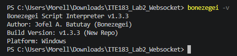
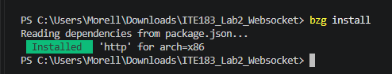
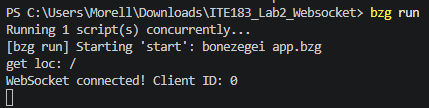
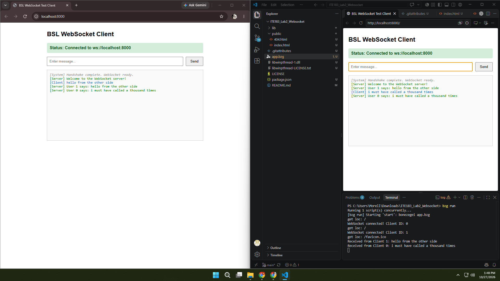
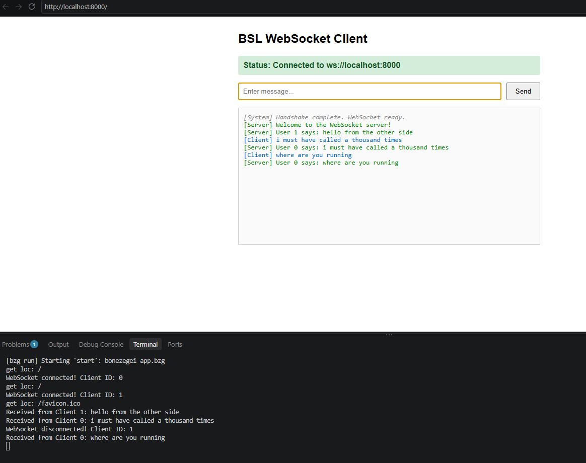
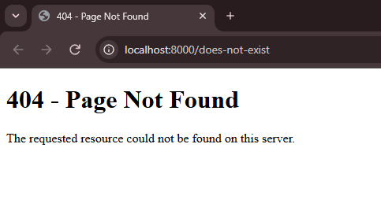

````markdown
# ITE183 Laboratory 2: WebSocket Server

A real-time multi-client chat application built using **Bonezegei Scripting Language v1.3.3**. This project demonstrates HTTP page serving, WebSocket connections, message broadcasting, client identification, and disconnection tracking.

## Features

- Serves the chat interface at `/`.
- Displays a custom error page for undefined routes.
- Establishes persistent WebSocket connections.
- Identifies connected clients using server-provided client IDs.
- Sends a welcome message to each connected client.
- Broadcasts messages to all connected clients.
- Logs connections, incoming messages, and disconnections.
- Supports sending messages using the Send button or Enter key.

## Technologies Used

- Bonezegei Scripting Language v1.3.3
- Bonezegei HTTP package
- HTML, CSS, and JavaScript
- WebSocket API
- Visual Studio Code
- Windows

## Project Files

| File or directory | Purpose |
|---|---|
| `app.bzg` | HTTP and WebSocket server implementation |
| `package.json` | Project metadata, start script, and dependencies |
| `.gitattributes` | Configures GitHub to classify `.bzg` files as JavaScript |
| `public/index.html` | WebSocket chat interface |
| `public/404.html` | Custom error page for undefined routes |
| `lib/` | Libraries installed through the Bonezegei package manager |
| `screenshots/` | Screenshots documenting installation and testing |
| `README.md` | Project documentation |
| `LICENSE` | MIT license |

## Requirements

- Bonezegei Scripting Language v1.3.3
- A modern web browser
- An internet connection for dependency installation
- Port 8000 available on the local computer

## Installation and Execution

### 1. Open the Project

Clone or download this repository and open its folder in Visual Studio Code.

Open a terminal in the project root, where `package.json` and `app.bzg` are located.

### 2. Verify the Interpreter

```powershell
bonezegei -v
```

Confirm that the installed version is **1.3.3**.

### 3. Install Dependencies

```powershell
bzg install
```

This installs the HTTP dependency specified in `package.json`. The server includes the library through `lib/http.bzg`.

### 4. Start the Server

```powershell
bzg run
```

Keep the terminal running while using the application.

### 5. Open the Chat Interface

Visit:

```text
http://localhost:8000/
```

The interface should display a connected status and a welcome message.

To stop the server, press **Ctrl + C** in the terminal.

## Testing

### Multi-client Broadcasting

1. Start the server.
2. Open `http://localhost:8000/` in two browser windows.
3. Confirm that both clients are connected.
4. Send a message from the first client.
5. Verify that both clients receive the broadcast.
6. Send a response from the second client.
7. Verify that the response appears in both clients.

The sender sees a local `[Client]` entry and a `[Server]` broadcast entry. This is expected because the broadcast includes the sender.

### Disconnection Tracking

1. Close one connected client.
2. Check the terminal for its disconnection message.
3. Send another message from the remaining client.
4. Confirm that the remaining client still receives the broadcast.

### Undefined-route Handling

Visit:

```text
http://localhost:8000/does-not-exist
```

The custom **404 - Page Not Found** page should appear.

## Verification Results

| Test | Observed result |
|---|---|
| Version verification | Bonezegei v1.3.3 displayed successfully |
| Dependency installation | HTTP package installed successfully |
| Server execution | Application started using `bzg run` |
| Client connection | Welcome message displayed and client ID logged |
| Message broadcasting | Messages delivered to both connected clients |
| Client disconnection | Disconnection logged in the terminal |
| Continued operation | Remaining client continued sending and receiving messages |
| Undefined route | Custom error page displayed |

## Screenshots

### 1. Version Verification



### 2. Dependency Installation



### 3. Server Startup



### 4. Multi-client Broadcasting



### 5. Disconnection Tracking



### 6. Custom Error Page



## How It Works

The server listens on port **8000**. An HTTP request to `/` loads the chat interface, which establishes a WebSocket connection to `ws://localhost:8000`.

When a client connects, `server.onConnect` logs its client ID and sends a welcome message using `server.send`.

Incoming messages trigger `server.onData`. The server uses `server.sendAll` to broadcast each message together with the sender's client ID.

When a client disconnects, `server.onDisconnect` records the event in the terminal.

## Scope and Limitations

- The supplied client is configured for testing on the same computer as the server.
- Messages are displayed during the current page session and are not stored in a database.
- The application does not implement user accounts or authentication.
- The local example uses unencrypted `ws://` connections.
- Undefined routes display the custom error page; the actual HTTP response status was not verified in the recorded tests.

## License

This project is licensed under the **MIT License**. See `LICENSE` for details.

## Reference

Developed for **ITE183 – Web Systems and Technologies, Laboratory 2: WebSocket Server**, following the provided laboratory instructions and adapting its sample implementation.
````